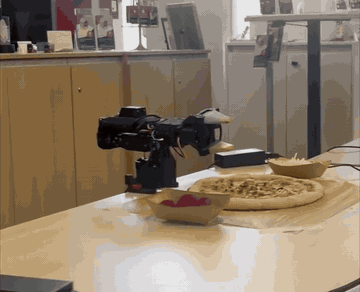

# Pizza-making robot with SmolVLA

1st place solution of the Robotics Pizza Hackathon (October 2026).

<p align="center"><br>
<sub>Full run: cheese, then pepperoni (8x speed)</sub></p>

The task was to teach a robot arm to make a pizza out of the props kit: spread cheese evenly and put pepperoni
slices on the pizza. We used ElRobot (7+1 DoF arm from NormaCore, 8 servos) with two cameras, one above the
table and one on the wrist. The robot completed all three challenges:

1. **Precision Topping**: 6 pepperoni slices spread over the pizza, and cheese spread over the pizza, each as a separate run.
2. **Recipe Assembly**: the whole pizza in one run from a written instruction, cheese first and then 6 pepperoni.
3. **Mystery Pizza**: a new pizza position, swapped bowls and a new recipe with a region ("6 pepperoni on the left
   half, then cheese over the whole pizza"). No new demos, fine-tuning or code changes were allowed.

## How it works

Long recipes are hard to learn as one policy. It has no memory, so it can't count slices or remember which
stage it is on. We split the work in two:

- the **policy** knows one short skill: take one piece (or one pinch of cheese) and put it into a given sector
  of the pizza, then go back home. The sector and the topping are given in the text prompt, e.g.
  `put the pepperoni on the top-left quadrant of the pizza`;
- a **script on top** (`robot/run_challenge.py`) turns the recipe into a list of steps, runs the policy once
  per step with the matching prompt and checks the result after every pepperoni step. If the slice did not
  land, the step is repeated (up to 2 times).

The rules allow this: everything that sends joint commands is the learned policy, and the script only picks
the prompt and decides when a step is done.

```
recipe text -> steps (topping, sector) -> SmolVLA, one prompt per step -> arm back home
                                              ^                                 |
                                              |   retry          top camera before/after
                                              +---- no ---- pepperoni added to the sector? (checker)
```

Example: "place 6 pepperoni on the left half, then spread cheese over the whole pizza" becomes 6 pepperoni steps
alternating top-left / bottom-left, then one cheese step per quadrant.

## Model

The policy is [SmolVLA](https://huggingface.co/docs/lerobot/smolvla) (`lerobot/smolvla_base`, ~450M params),
fine-tuned with LeRobot 0.3.3.

- Backbone: SmolVLM2-500M (vision + language), followed by an action expert that predicts actions with flow
  matching (10 denoising steps).
- Input: top and wrist camera frames, positions of all 8 joints, the text prompt.
- Output: a chunk of 50 target joint positions. Data is recorded at 10 Hz, so one chunk is about 5 s of motion.
- Fine-tuning: vision encoder and VLM frozen, only the action expert and the state projection are trained.
  20k steps, batch 64, lr 1e-4 with 1k warmup and cosine decay, image augmentations on. One checkpoint for
  all toppings and sectors. Training ran on the GPU box (DevLab) the organizers gave us.

Before that we tried ACT (`v1/`): four separate models, one per quadrant, 30k steps each. ACT can't read a
prompt, so every sector needs its own checkpoint, and that does not scale to recipes with regions. With
SmolVLA one checkpoint covers everything and the prompt chooses the sector.

## Data

Teleoperation with the leader arm, recorded in NormaCore Station. One episode is one piece (or one pinch of
cheese) into one target sector. Every recording has a manifest with the target sector and round number per
episode.

| Dataset | Rounds | What |
|---|---|---|
| `cheese-r1r10` | 10 | cheese into each quadrant |
| `pepperoni-r1r10` | 10 | pepperoni slices on an empty pizza |
| `pepperoni-on-cheese-r1r5` | 5 | pepperoni on a pizza already covered with cheese, as in Recipe Assembly |

Targets are the four quadrants (TL, TR, BR, BL) plus the center. Processing (`data/`):

1. `a_prompts.py` writes the per-episode prompt from the manifest into the Station parquet.
2. The organizers' exporter turns it into a LeRobot v2.1 dataset (cameras named `top` and `front`).
3. `analyze.py` flags bad episodes: long pauses, possible empty grasps.
4. `c_compat.py` cuts idle frames at the start and end, merges everything into one training set and fixes the
   metadata for LeRobot 0.3.3. It also builds two variants with the gripper state or the whole state zeroed
   (`nogripper`, `nostate`), to check how much the policy relies on joint positions.

## Checker

To know whether a step worked we compare the top camera frame before and after the step. A ResNet18 takes the
crop of one sector, 6 channels: the "after" image and the "after minus before" difference. It outputs the
probability that cheese or pepperoni was added in that sector (`checker/h_train_change.py`).

Trained on pairs from our own episodes (`g_pair_dataset.py`), rounds 5 and 10 held out for validation. On the
held-out rounds with threshold 0.65 it found 357 of 360 pepperoni placements with 4 false alarms. On cheese it
was close to a coin flip, so only pepperoni steps are checked.

For Mystery Pizza the pizza can be moved, and fixed sector boxes would no longer match. `pizza_locator.py`
finds the sauce by color (red channel in Lab, Otsu threshold) once at the start of the run, and the sector
boxes are shifted with it. Shifts up to 4 px are treated as noise. If the pizza is not found or moved more than
15 px, it falls back to the fixed boxes. Details and measurements: [checker/FAILURE_CHECKER_V2.md](checker/FAILURE_CHECKER_V2.md).

## Repo layout

```
pipeline.sh   whole training pipeline: prep / policy / checkers
data/         prompts, idle frame cleaning, dataset merge, episode QA
checker/      sector ROIs, topping and change checkers, pizza locator, failure checker
robot/        run_challenge.py (recipe runner), run_lerobot_policy.py (one policy, one prompt)
v1/           first try: cheese only, ACT per quadrant or one SmolVLA
env/          pinned requirements, setup script, env check
norma/        NormaCore SmolVLA trainer, patched to read the joint count from the data (8 on ElRobot)
```

## Datasets and weights

| What | Link |
|---|---|
| Datasets (Station parquet + manifests, LeRobot v2.1) | coming soon |
| SmolVLA checkpoint | coming soon |
| Checker models (`roi.json`, `checker.pt`, `change.pt`) | coming soon |

They are not in the repo. Scripts expect them in the home dir:

| What | Where |
|---|---|
| Station recordings + manifests | `~/datasets/<name>.parquet`, `<name>.manifest.json` |
| Converted and merged datasets | `~/v2/station`, `~/v2/lerobot`, `~/v2/lerobot_compat/<variant>` |
| Policy checkpoints | `~/outputs/smolvla_v2_<variant>` |
| Checker models | `~/v2/checker/` (`roi.json`, `checker.pt`, `change.pt`) |

## Setup

```bash
bash env/setup.sh
conda activate lerobot
```

Creates the conda env `lerobot` (Python 3.10, torch 2.7.1+cu128, lerobot 0.3.3, all versions pinned in
`env/requirements.lock`), clones NormaCore at the Station version from the hackathon (`v0.1.0-beta.10`) into
`~/norma-core` and the organizers' repo with the exporter into `~/robot-pizza-cup`, then runs
`env/check_env.py`. Needs an NVIDIA driver with CUDA 12.8 support (570+).

Training reads video with pyav (`--dataset.video_backend=pyav`), because the torchcodec build that LeRobot
installs does not load without the CUDA NPP libs.

## Training from recordings

Put the three Station recordings with their manifests into `~/datasets`:

```
~/datasets/cheese-r1r10-2026-10-24.parquet                 + .manifest.json
~/datasets/pepperoni-r1r10-2026-10-24.parquet              + .manifest.json
~/datasets/pepperoni-on-cheese-r1r5-2026-10-24.parquet     + .manifest.json
```

The names are hardcoded in `SOURCES` / `ADDED` / `LABELS` at the top of the scripts in `data/` and `checker/`
(and in `pipeline.sh`), so for other recordings change them there. Each manifest needs per episode
`episode_start_ns`, `task` (the prompt), `target` (TL, TR, BR, BL, CENTER or GAP) and `round`.

Then run the three stages:

```bash
conda activate lerobot
bash pipeline.sh prep                    # recordings -> ~/v2/lerobot -> ~/v2/lerobot_compat/{full,nogripper,nostate}
VARIANT=full bash pipeline.sh policy     # SmolVLA -> ~/outputs/smolvla_v2_full
bash pipeline.sh checkers                # ~/v2/checker: roi.json, checker.pt, change.pt
```

- `prep` also writes `~/v2/analysis/flagged.csv` with suspicious episodes. Episodes listed in `~/v2/exclude.json`
  (`{"<dataset>": [episode_index, ...]}`) are skipped by the checker scripts.
- `policy` takes `STEPS` (default 20000) and `OUT`. Checkpoints are saved every 5000 steps to
  `$OUT/checkpoints/<step>/pretrained_model`, the latest one also as `checkpoints/last`. The log goes to
  `~/train_<name>.log`. There is no offline eval, try a few checkpoints on the robot.
- `checkers` builds the sector boxes around the sauce circle `PIZZA="cx cy r"` (default `118 131 28`, our camera,
  as in `checker/roi.json`), learns which target goes to which image quadrant from the data, then trains both
  checkers. Look at `~/v2/checker/roi_overview.jpg`: the boxes should sit on the pizza. With a different camera
  pose measure the circle on a top frame and pass it in `PIZZA`.

Stages can be run separately and in any order once `prep` is done.

## Running with trained weights

You need:

- the policy checkpoint, a `pretrained_model` folder (`config.json` + `model.safetensors`);
- the checker files `roi.json` and `change.pt` in `~/v2/checker` (or pass `--checker-dir`). Without them run
  with `--failure-checker off`: no checks and no retries, everything else works;
- NormaCore Station running on the machine the arm is plugged into (`~/norma-core` from `env/setup.sh`,
  or `bash scripts/run.sh` in `~/robot-pizza-cup/elrobot`), and the follower bus serial from the Station
  web UI (http://localhost:8889).

The pizza locator also wants a reference top-camera frame with the pizza at its usual place. If you have the
converted data it can be taken from there:

```bash
python -c "import sys; sys.path.insert(0, 'checker'); from failure_checker_v2 import reference_frame; \
from PIL import Image; Image.fromarray(reference_frame()).save('$HOME/v2/checker/ref_top.png')"
```

Otherwise save one frame from the top camera with the arm at home and an empty pizza in place.

Start with the arm at home: the pose at connect is taken as home, and a step ends when the arm comes back there.

```bash
# 1. steps and prompts only, no robot needed
python robot/run_challenge.py ch2 --plan-only

# 2. connect, find the pizza, save the overlay to logs/dry/start.png; the arm does not move
python robot/run_challenge.py ch2 --dry-run --bus-serial <FOLLOWER_SERIAL> \
    --checker-ref ~/v2/checker/ref_top.png --checker-log logs/dry

# 3. real run
python robot/run_challenge.py ch2 \
    --checkpoint ~/outputs/smolvla_v2_full/checkpoints/last/pretrained_model \
    --bus-serial <FOLLOWER_SERIAL> \
    --checker-ref ~/v2/checker/ref_top.png --checker-log logs/run1

# any recipe, e.g. Mystery Pizza part B
python robot/run_challenge.py recipe --checkpoint ... --bus-serial ... \
    --recipe "Build a pizza: place 6 pepperoni on the left half, then spread cheese over the whole pizza."
```

`ch1-cheese`, `ch1-pepperoni`, `ch2` and `ch3a` are the fixed challenge recipes, `recipe` takes any text. Some
useful flags:

- `--prompts prompts.json`: prompts for each `topping:SECTOR` if they differ from the default template. They
  have to match the training prompts exactly, `--tasks-jsonl <dataset>/meta/tasks.jsonl` checks that;
- `--zero-state-dims 7` or `0,1,2,3,4,5,6,7` for `nogripper` / `nostate` checkpoints;
- `--time-limit`: no new step after this many seconds (3 min for challenge 1, 8 min for 2 and 3);
- `--norma-root` if NormaCore is not in `~/norma-core`.

The log in `--checker-log` has `events.jsonl` and an overlay image for every checked step, handy to see why a
step was repeated. `python robot/run_challenge.py --help` lists everything else (step timeouts, home tolerance,
retries).

## v1: cheese only

The first version, kept for reference. One episode per quadrant, 4 episodes per round going clockwise.

```bash
python v1/01_add_quadrant_prompts.py ~/datasets/cheese-fixed-s1-2026-10-24 ~/quadrant_src
bash   v1/02_convert_to_lerobot.sh ~/quadrant_src ~/lerobot_cheese
python v1/03_make_compat_datasets.py
bash   v1/train_act.sh        # 4 ACT models -> ~/outputs/act_<quadrant>
bash   v1/train_smolvla.sh    # 1 SmolVLA    -> ~/outputs/smolvla_quadrants
```

ACT ignores the prompt, so it is run with one checkpoint per quadrant:
`robot/run_lerobot_policy.py --n-action-steps 10`.
